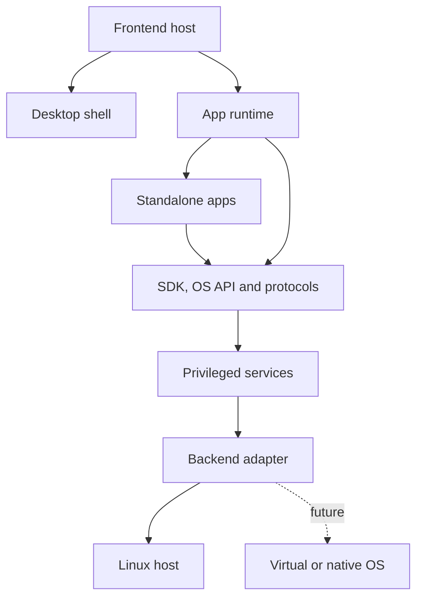
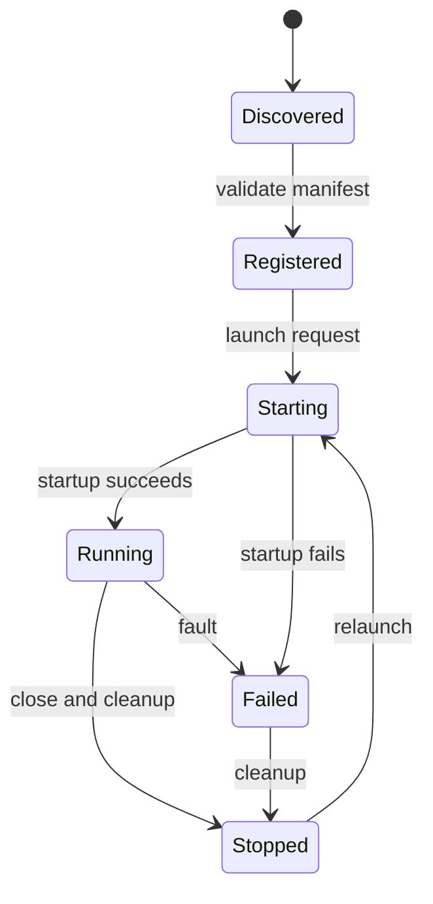
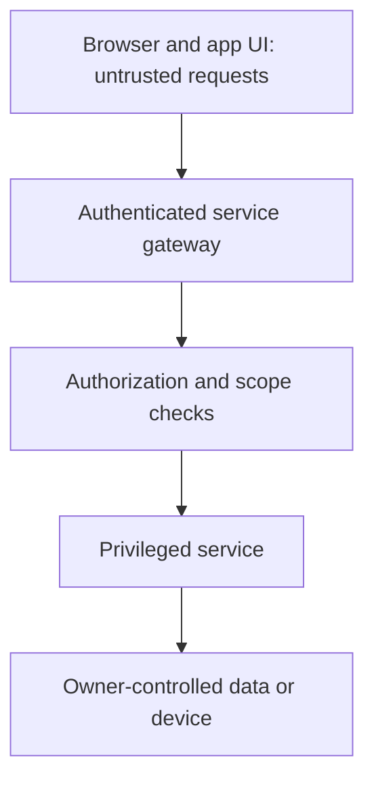

# PWOS-002 — System Architecture Foundation

**Governing charter:** [PWOS-001 — Project Charter](../foundation/PWOS-001-project-charter.md)  
**Documentation conventions:** [Documentation Guide](../DOCUMENTATION-GUIDE.md)  
**Document status:** **Accepted architecture baseline**. The project owner explicitly authorized review and formal approval of v0.2 on 2026-10-27. Acceptance approves the eight design selections in §12; it does **not** mean the planned subsystems are implemented or security-certified.

## 1. Purpose and scope

PWOS-002 defines the **intended long-term logical architecture** of Personal OS so its repository can be organized around durable ownership and replaceable execution backends from the beginning.

It establishes:

1. System layers, module responsibilities and interface boundaries.
2. Rules for public contracts versus private implementations.
3. Application hosting, discovery and lifecycle responsibilities.
4. Security and authority boundaries.
5. Linux, virtual and original-kernel integration strategy.
6. Source-tree ownership, validation gates and selected design decisions.

It selects a **provisional kernel implementation language and development strategy**, but does **not** select a final AI model, approve internet exposure, guarantee cross-runtime binary compatibility, or claim that proposed subsystems have been implemented. Detailed functional requirements, security threat models, schemas and kernel algorithms will need their own approved specifications.

## 2. Architecture principles

| Principle | Consequence |
| --- | --- |
| **Host independence** | `apps/web` initializes the browser experience but does not own reusable shell/runtime internals. |
| **Independent applications** | User-facing applications are workspace targets under `apps/*`, not private folders of the web host. |
| **Explicit contracts** | Apps depend on versioned SDK/OS API contracts, never on the implementation of a particular backend or host. |
| **Least authority** | Privileged services enforce permissions; a React context or manifest is not itself a security boundary. |
| **Language-neutral interoperability** | Wire contracts are defined independently of TypeScript so native services and a future kernel can implement them. |
| **Evidence before migration** | A new backend is supported only after conformance, isolation and reliability tests pass for an advertised capability set. |
| **Working system continuity** | Structural migrations preserve a runnable web build and do not depend on custom-kernel completion. |
| **Owner control** | Private production storage and inference remain on self-hosted infrastructure, with independently tested recovery. |

## 3. Conceptual system architecture



Arrows indicate conceptual dependencies or service interaction, **not** mandatory direct imports, single-process deployment, or an approved message transport. The browser shell presents applications; the runtime manages their host lifecycle; system-service implementations authorize and perform privileged work. The future guest/native path is not operational.

### 3.1 Architectural layers

| Layer | Target owner | Responsibility | Initial state |
| --- | --- | --- | --- |
| Web delivery host | `apps/web/` | Browser bootstrap, root composition, routing and deployment entry point | Exists; currently contains shell internals |
| Alternative host | `apps/desktop/` | Reserved for a separate native/embedded frontend host using public shell/runtime contracts | Placeholder; not activated |
| Reusable shell | `packages/desktop-shell/` | Desktop, launcher, dock, windows, system panels and widgets | Manifest, source-level component/type exports, and standalone `DesktopShell.tsx` layout present; type checking verified; package-name mapping and host integration pending |
| Application runtime | `packages/app-runtime/` | Discovery, lifecycle, host integration, and isolation coordination | Proposed; not implemented |
| Applications | `apps/file-manager/`, `apps/ai-assistant/`, later app workspaces | Independently owned user functionality | Planned placeholders |
| App SDK | `packages/app-sdk/` | Public app interfaces, manifests, capability requests, lifecycle hooks | Package identity reserved; no public API |
| OS API | `packages/os-api/` | Backend-neutral service contract types, errors and versioning | Package identity reserved; no public API |
| Protocols | `packages/protocols/` | Language-neutral serialized schemas and transport contracts | Planned placeholder |
| Privileged services | `services/` | File, identity, process, networking, AI and application services | Not implemented |
| Backend adapters | `backends/linux/`, `virtual/`, `native/` | Bind service contracts to a supported execution environment | Planned placeholders |
| Kernel | `kernel/` | Original boot, scheduling, protection, memory, IPC and hardware work | Research only |
| Platform | `platform/` | Device support, images, deployment and boot integration | Planned |

The implemented Fastify API in `apps/api/` is a **status-only starter**, not yet the service gateway described in this target architecture. See [§12](#12-finalized-architecture-decisions) for the selected design boundaries that these modules must eventually implement.

### 3.2 Proposed static-preview deployment profile

**Status: proposed clarification for owner review; not a ninth accepted ARC decision.** The same frontend host and shared desktop shell may be built for two delivery profiles:

| Concern | Public GitHub Pages demo | Private Raspberry Pi host |
| --- | --- | --- |
| Delivery | Static HTML/CSS/JavaScript artifact | Browser frontend and separately deployed private services |
| Data | Public samples or explicitly non-sensitive mock content | Authorized owner data through trusted service contracts |
| Capabilities | Presentation and explicitly demo-only behavior | Capability discovery and service-enforced privileged operations |
| AI/storage | Unavailable or clearly marked simulations | Self-hosted inference and storage after D2/D3 validation |
| Security assumption | **Public and inspectable**; no secrets or private service connectivity | Authenticated and authorized private access subject to threat review |

The shell should render advertised capabilities but not decide privilege. A frontend host must not hardcode public-demo service endpoints inside shared packages. For a future Vite-based Pages build, configure project-subpath assets (`/personal-os/` unless a custom domain changes the base), deterministic client-side navigation/reload behavior, and a static build artifact published by GitHub Actions. Validate direct deep links, missing routes and cache updates before release. Pages cannot execute backend services. **No public Pages preview is currently deployed.**

This deployment profile supplements the accepted host-independence and least-authority principles. **Any direct connection from the public demo origin to private Pi services requires its own threat model, consent and architecture approval**; it is out of scope for the static D0 demo.

## 4. Dependency and ownership rules

The intended source-dependency direction is:

| Module | May depend on | Must not depend on |
| --- | --- | --- |
| Frontend host | Public desktop-shell/runtime entry points, shared UI, frontend client bindings | Private shell internals, kernel/drivers, privileged backend implementation |
| Desktop shell | Public app-runtime controls, UI/design-system modules, frontend status interfaces | Specific standalone application's source tree, Linux-only service details |
| Application runtime | SDK/OS API contracts, protocol definitions, host-provided adapters | Private app implementation modules as hardcoded dependencies |
| Standalone application | `@personal-os/app-sdk`, `@personal-os/os-api`, supported UI modules | `apps/web/src/`, private shell state, privileged service source |
| Public contract packages | Portable types, schemas and carefully documented dependencies | React-only shell logic, backend service implementations |
| Privileged services | Contract schemas, authorization infrastructure, configured backend interfaces | Application UI internals or trust in caller-supplied permission declarations |
| Backend adapters | Public service contracts and host/kernel execution primitives | React and desktop UI implementation |
| Original kernel | Architecture-specific low-level code and explicitly required kernel facilities | Browser frameworks, application UI/runtime implementations |

Cross-layer communication may use local function calls **only within the same trust domain**. Crossing a process, VM, browser or privilege boundary requires a specified protocol, identity and authorization strategy. Circular dependencies between public contract packages and their implementations are prohibited.

### 4.1 Shared contracts versus shared code

`packages/desktop-shell/` and `packages/app-runtime/` are reusable **implementations**. `packages/os-api/` and `packages/protocols/` are **interfaces**.

A future native File Manager might not use React or TypeScript. It must implement the applicable app/service protocol semantics rather than share browser source code. Portable **behavior** is the compatibility goal; identical binaries, UI frameworks and performance are not guaranteed.

## 5. Applications and runtime

### 5.1 Ownership model

- The **shell** owns its launcher, About panel, window chrome, dock and widgets. These are host facilities, not automatically separate deployable applications.
- The **application workspace** owns its own UI, state and domain behavior.
- The **runtime** owns app discovery, launch/close lifecycle, host association, permitted communication and cleanup.
- The **SDK** offers stable, narrow app-facing APIs; the **OS API** describes the system capabilities they request.
- The **services** make enforceable authorization decisions and perform protected actions.

### 5.2 Selected application contract

Each independently built application will provide a versioned **JSON manifest** validated at build or installation time, containing at least:

| Field/concern | Intended meaning |
| --- | --- |
| Application identifier | Stable, unique namespace |
| Version and compatibility | App version and required SDK/protocol versions |
| Entry point | Documented host-compatible execution entry |
| Capabilities requested | Narrow file/AI/system permissions with defined scopes |
| Lifecycle hooks | Open, activate, suspend/resume where supported, close and cleanup |
| Isolation policy | Execution domain and restrictions determined by trust level |

**A manifest is a declaration, not permission.** Apps cannot authorize their own privileges; the runtime and privileged services must separately validate authorization. The first runtime will **bundle or pre-register trusted first-party applications**, with a generated/static registry and lazy-loaded app entry points. Runtime installation of arbitrary third-party code is **out of scope** until a separate isolation review. The current static shell registry may remain until a proven host/runtime contract replaces it.

### 5.3 Proposed lifecycle



Suspension and background execution are deferred until resource and lifecycle budgets have been verified. The selected first lifecycle is **discovered → registered → starting → running → stopped/failed** with cleanup and idempotent close behavior. This diagram is a design target, not an implemented state machine.

## 6. OS API and protocol boundaries

Public API design should begin with a **small capability subset** exercised by a real application. Proposed domains include:

| Domain | Example responsibility | Security note |
| --- | --- | --- |
| System | Read sanitized status and feature availability | No private diagnostics by default |
| Files | List/read/write only authorized owner-scoped objects | Service-enforced scopes; no arbitrary host path access |
| Identity | Session identity, authentication and recovery | Trusted service owns credentials and authorization |
| Processes | App-visible lifecycle and narrow task operations | No unrestricted process or shell access |
| Networking | Approved requests and endpoint policy | Protect internal services and private networks |
| AI | Local inference and permissioned tool requests | AI output never grants authority on its own |

Each approved operation will require: **contract version, inputs, outputs, errors, authorization scope, transport binding, timeout/cancellation behavior, and conformance tests**. The selected initial browser-to-service transport is **same-origin HTTPS with JSON request/response bodies**, described by language-neutral machine-readable schemas. Local or VM backends may use different transports through adapters. A versioned envelope should include operation name, protocol major/minor version, request identifier and structured error code. A major-version mismatch must fail explicitly; minor capabilities are negotiated/discovered rather than assumed. Avoid treating a TypeScript interface alone as a cross-kernel protocol specification.

No public interface is yet considered stable simply because the corresponding package directory has a `package.json`.

## 7. Security and trust boundaries



The design assumes the browser and applications can submit malformed or hostile input even during single-owner use. Backend checks are mandatory for any operation touching credentials, private files, system processes, model tool execution or host configuration.

Initial protection goals:

1. Explicit authentication before private service access; no public-facing production access until review.
2. Least-privilege authorization scoped to the session, application and requested resource.
3. No application-provided permission declaration treated as an authority token.
4. Persistent personal data isolated from replaceable application deployment artifacts.
5. Auditable sensitive operations without recording secrets or unnecessary private content.
6. Clear isolation distinction between first-party trusted apps and any future untrusted extension model.

**Selected trust model:** The first-party D0/D1 bundle is treated as **trusted application code** executing in the same frontend origin, with **no security isolation claim between its modules**. Browser-side manifests and runtime checks improve structure but do not grant real isolation. Before any untrusted extension is supported, require a **separate sandboxed origin or process boundary**, a narrowly scoped message bridge, and a dedicated threat model; the exact sandbox implementation is an implementation-gated decision. Trusted services must enforce every privileged authorization decision, independently of frontend checks.

For the first private Pi service, use **one owner identity** and server-managed sessions carried in securely configured, non-JavaScript-readable cookies over HTTPS. Defend state-changing requests against CSRF and validate session lifetime, renewal and logout; owner recovery must not rely solely on the live Pi. The concrete credential mechanism and recovery procedure require security review and tests before D2. No production credential or session mechanism is implemented today.

## 8. Services, storage and local AI

### 8.1 Services

The `services/` tree is intended to hold separately owned services for identity, filesystem, process-related operations, networking, AI and application management. These can initially be co-deployed on Linux if their contracts and privilege boundaries are respected; one directory does not imply one process.

### 8.2 Storage

The target is a **Pi-hosted personal cloud**, not an external storage provider. The selected first storage design is **SQLite for metadata plus ordinary files/blobs on an SSD-backed data volume**, accessed only through an authorized filesystem service. File identifiers must be opaque to applications; raw host filesystem paths must not become public API. Persistent state must live outside replaceable application binaries/containers. Backups must capture a **consistent metadata-and-blob snapshot**, include integrity checks, live on separate owner-controlled media and pass a restore drill before D2 acceptance.

The first development-only app can use non-sensitive mock or local data, but that implementation must not silently become the production storage or security model.

### 8.3 AI

Local AI inference is a service capability, not desktop-shell business logic. The selected approach is a **replaceable local inference adapter** behind an authenticated AI service contract, reachable only over loopback or another private host-controlled connection. The assistant never connects directly to an unrestricted model-tool bridge. Tool actions require separately granted scopes and service-side enforcement; model-generated text cannot authorize file or system access.

The **inference engine and model are intentionally not selected yet**: the architectural decision is to keep them replaceable, then choose an implementation from measured Raspberry Pi 5 RAM, latency, throughput, energy and accuracy feasibility. An offline test must demonstrate that inference does not require a third-party cloud.

## 9. Execution backends and original kernel

| Mode | Service execution | Status and gate |
| --- | --- | --- |
| **Linux** | Initial services operate on Linux on Raspberry Pi 5 | Initial deployment target; private Pi operation not verified |
| **Virtual/hybrid** | Selected services or programs operate in an original OS guest with a defined host bridge | Research path; requires emulator boot and contract conformance |
| **Native** | Original kernel and userspace support the agreed service subset on supported hardware | Long-term research path; requires drivers, security and system validation |

`backends/` binds service interfaces to execution environments. It should not change app-facing semantics without explicit capability negotiation and versioning. A shared conformance suite should exercise both supported behavior and expected unsupported-capability errors.

The experimental kernel remains a distinct low-level codebase with architecture, boot, memory, scheduler, IPC, capability, interrupt and driver responsibilities. The **selected research baseline** is **Rust `no_std` on AArch64**, first booted and tested in a controlled emulator, using a **capability-oriented small privileged core** with explicit message-passing interfaces. Higher-level services and as many drivers as practical should live outside the privileged core. Native Pi support comes only after emulator evidence and hardware bring-up research. This is a **revisable research hypothesis**, not proof that a microkernel architecture will satisfy all performance or hardware needs.

## 10. Target repository ownership

The following is the **accepted target logical tree**, not the current physical directory inventory:

```text
personal-os/
├── apps/
│   ├── web/                # Thin browser host
│   ├── api/                # Initial status/API server host
│   ├── desktop/            # Reserved alternative host
│   ├── file-manager/       # Standalone user app
│   ├── ai-assistant/       # Standalone user app
│   ├── settings/
│   └── terminal/
├── packages/
│   ├── desktop-shell/      # Shared desktop implementation
│   ├── app-runtime/        # Application hosting
│   ├── app-sdk/            # App-facing contracts
│   ├── os-api/             # Backend-neutral contracts
│   ├── protocols/          # Wire schemas
│   ├── ui/
│   ├── design-system/
│   └── tsconfig/
├── services/
│   ├── identity/
│   ├── filesystem/
│   ├── process/
│   ├── networking/
│   ├── ai/
│   └── application/
├── backends/
│   ├── linux/
│   ├── virtual/
│   └── native/
├── kernel/
│   ├── arch/
│   ├── boot/
│   ├── memory/
│   ├── scheduler/
│   ├── ipc/
│   ├── capabilities/
│   ├── interrupts/
│   └── drivers/
├── platform/
│   ├── raspberry-pi/
│   ├── virtual-machines/
│   ├── bootloader/
│   └── deployment/
├── tools/
│   ├── build/
│   ├── developer/
│   └── diagnostics/
├── tests/
│   ├── unit/
│   ├── integration/
│   ├── conformance/
│   ├── security/
│   └── system/
└── docs/
```

### 10.1 Current state versus target

The supplied repository snapshot includes an earlier `apps/web/src/shell/` implementation with the launcher, About, dock, window manager, widgets, registry and browser state; `apps/api/` provides status endpoints. Current development is proceeding **independently in `packages/desktop-shell/`**, where `package.json`, `src/index.ts` source-level `DesktopShell`/type exports, and a standalone `DesktopShell.tsx` presentation frame now exist. The owner verified workspace installation and shell TypeScript checking in Codespaces on 2026-10-28; the package still lacks a manifest `exports` map and browser host integration, so the new shell is **not yet viewable through a browser preview URL**. `packages/tsconfig/` and `packages/ui/` provide small shared foundations; `packages/app-sdk/` and `packages/os-api/` reserve identities with **no stable exports**. `packages/app-runtime/` is not implemented. This is a factual status update, not a revision to the accepted architecture decisions.

The reusable shell can be implemented before a new frontend host is started, then connected through documented public exports. If the earlier web starter is reused or migrated, preserve its D0 capabilities. Keep the frontend bootstrap small, but do not force the future kernel or native UI to depend on React.

## 11. Verification and architecture acceptance

| Gate | Evidence required |
| --- | --- |
| Repository structure | Workspace/package names resolve; intended import directions are documented; no duplicate owners |
| Shell extraction | Browser desktop still starts; launcher, dock, About, window interactions and status requests still work |
| Public API introduction | Contract tests include success, permissions failure, malformed input and unavailable capability |
| Standalone app support | Independent app builds without importing `apps/web/src/`; documented lifecycle and host interface |
| Privileged service readiness | Threat review, authn/authz negative tests, persistent data isolation, recovery verification |
| New backend claim | Conformance suite and supported-capability matrix pass on that backend |
| Original kernel claim | Reproducible emulator/hardware evidence for the specifically claimed mechanisms |

Documentation status and implementation status are separate. **PWOS-002 acceptance** requires owner review of the selected ARC decisions and their explicitly deferred parameters. It does not certify that any listed subsystem works.

## 12. Finalized architecture decisions

The following choices form the **owner-approved PWOS-002 v0.2 architecture baseline**. “Finalized” means they govern future implementation planning; it does **not** mean they have been implemented, benchmarked or security-certified. Revisions require an explicit architecture review and traceable version change.

| ID | Selected decision | Why this approach | Required evidence / remaining parameters |
| --- | --- | --- | --- |
| **ARC-01 — Hosts** | `apps/web/` remains the browser delivery host; `apps/desktop/` is reserved for a **distinct future native/embedded host** consuming shared shell/runtime interfaces. Neither owns a duplicate shell. | Keeps frontend delivery separate from reusable logic and prevents competing desktop implementations. | Extract shell package without behavior regression; do not activate desktop host until its UI technology/target is justified. |
| **ARC-02 — App packaging** | First-party apps build independently as monorepo workspaces and declare a versioned **JSON manifest**. The first runtime uses a **build-time/installed registry** and host-compatible lazy entry points. | Supports independent ownership while avoiding premature dynamic code installation. | Define manifest schema, validation, compatibility rules and open/close lifecycle tests. |
| **ARC-03 — Isolation** | First-party bundled modules are **trusted code in the same origin** and are not claimed to be sandboxed. Sensitive operations always require server-side authorization. Future untrusted code requires isolated origin/process and narrow RPC. | Makes the current trust model honest and prevents frontend-only permissions from being mistaken for enforcement. | Negative authorization tests now; threat model and browser/process isolation proof before any untrusted app support. |
| **ARC-04 — Protocols** | Use **schema-defined JSON over same-origin HTTPS** for browser-to-service operations; identify request, operation, major/minor protocol version, errors and capabilities. Use adapters for other transports. | Makes contracts inspectable and usable by clients written in other languages; transport remains replaceable. | Define canonical schemas, version negotiation, compatibility/error behavior and cross-backend conformance suite. |
| **ARC-05 — Identity** | First private deployment supports **one owner**, server-managed sessions over HTTPS, properly protected session cookies and explicit authorization scopes. Protect state-changing requests from CSRF; plan offline recovery. | Matches owner-operated scope while securing privileged data operations at trusted services. | Choose credential and recovery specifics after threat review; test login, expiry, CSRF, privilege denial and recovery before D2. |
| **ARC-06 — Storage** | Use **SQLite metadata plus SSD-backed file/blob storage**, hidden behind an authorized filesystem service; keep application deployments separate from data. Backup metadata and blobs consistently to separate media. | Small, inspectable self-hosted starting point with clear migration and recovery boundaries. | Define identifier/path rules, schema migrations, transactional consistency, backup retention and restore drills before real files. |
| **ARC-07 — Local AI** | Keep a **replaceable local inference adapter** behind the private AI service. Do **not** select a model or engine until Pi benchmarks; AI tools always pass explicit service-side permission checks. | Preserves a self-hosted architecture without gambling on an unmeasured inference stack. | Benchmark on chosen hardware, verify offline inference and tool denial, then record the selected engine/model separately. |
| **ARC-08 — Kernel research** | Begin with **Rust `no_std`, AArch64 emulator-first**, and a **capability-oriented small kernel core** with explicit IPC; put higher services outside the core where practical. | Supports rigorous isolation experiments and avoids making hardware bring-up the first prerequisite. | Validate boot, memory isolation, IPC and exception handling in emulator; reassess privilege split/performance before Pi-native work. |

### 12.1 What is decided versus deferred

**Architecture choices selected:** ownership of web/desktop hosts; placement of shell/runtime; bundled first-party manifest model; initial trusted-app assumption; server-enforced permissions; JSON/HTTPS initial public transport; single-owner service boundary; SQLite-plus-blobs storage direction; replaceable local AI adapter; emulator-first Rust kernel research.

**Implementation parameters still deferred:** the exact manifest schema and loader, untrusted-app sandbox technology, credential and account recovery mechanism, concrete file schema and backup retention, AI engine/model, kernel IPC wire format, driver split and Raspberry Pi board bring-up details. Deferral is intentional; a concrete choice is required before the corresponding capability is claimed.

### 12.2 Architecture change control

1. Record an affected ARC identifier and the proposed replacement choice.
2. Explain the tradeoff, compatibility and security impact, including any changes to PWOS-001 scope.
3. Identify contract, integration and conformance tests that must change.
4. Update the PWOS-002 version and relevant documentation summaries.
5. Obtain owner approval before describing the revised architecture as accepted.

Key risks remain premature complexity, privilege inheritance across frontend boundaries, false portability promises, inconsistent backups, and Pi resource exhaustion. The decisions above reduce ambiguity but **do not replace implementation validation or threat modeling**.

## 13. Governance, references and next work

This document elaborates the direction stated in [PWOS-001](../foundation/PWOS-001-project-charter.md). Both documents are now accepted; any future scope conflict must be reconciled explicitly. Acceptance of PWOS-002 does not silently supersede the charter.

**Approval record:** **Approved** — PWOS-002 v0.2, by the project owner (Saul), on **2026-10-27**, following the explicit instruction to review and formally approve this version. Approval covers the architecture boundaries and ARC-01–ARC-08 choices, **not** implementation readiness, unresolved design parameters, or deployment security.

**Review conclusion:** The layer ownership, dependency direction, application trust assumption, selected service contracts, and kernel research direction are internally compatible with PWOS-001. No blocking architecture contradiction was identified. PWOS-001 v0.12 was subsequently accepted on 2026-10-28; future changes to its scope may trigger PWOS-002 review.

Recommended next work, in order:

1. Extract existing browser shell code into `packages/desktop-shell/` while preserving a working D0 preview.
2. Define the narrow first-party manifest schema and minimal app runtime against the accepted trust model.
3. Introduce schema-defined API contracts and test denied, malformed and unsupported-capability requests.
4. Validate an independent application build without private imports from the web host.
5. Draft testable system requirements in a **new, uniquely numbered specification** when ready; do not reuse the historical PWOS-002 requirements draft as an approved baseline.

### Security design references

The selected session and authorization approach should be evaluated against the [OWASP Session Management Cheat Sheet](https://cheatsheetseries.owasp.org/cheatsheets/Session_Management_Cheat_Sheet.html), [OWASP CSRF Prevention Cheat Sheet](https://cheatsheetseries.owasp.org/cheatsheets/Cross-Site_Request_Forgery_Prevention_Cheat_Sheet.html) and [OWASP Authorization Cheat Sheet](https://cheatsheetseries.owasp.org/cheatsheets/Authorization_Cheat_Sheet.html). These resources inform the security requirements; citing them does not substitute for a project threat model or tests.

**Design rule:** Keep the frontend host thin, reusable implementations independently owned, public service contracts backend-neutral, and privileged authority enforced outside untrusted application UI.
