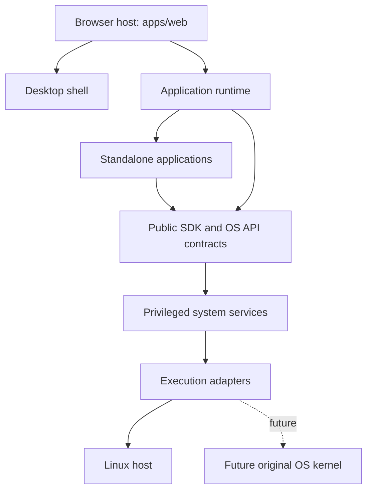

# Personal OS
## Project Charter and Foundational Delivery Strategy

**Repository:** `personal-os` (formerly `personal-web-os`)  
**Documentation home:** [Documentation Index](../README.md)

**Review note:** Version 0.12 was formally accepted by the project owner on 2026-10-28. It establishes project direction and early delivery gates; [PWOS-002](../architecture/PWOS-002-system-architecture-foundation.md) is the accepted detailed architecture baseline. Approval does not mean the proposed product capabilities are implemented.

---

## 1. Vision

Personal OS is an original, self-hosted personal computing environment accessed through a website. The user opens a browser, signs in, and loads a desktop with applications, files, system settings, and locally hosted AI capabilities.

The project starts as a web-native operating environment and preserves the possibility of evolving into a hybrid system or a virtual computer using an original kernel. Its priorities are user ownership, modularity, extensibility, security, and the development of in-house software.

The **repository name** is `personal-os`; the stable `PWOS` documentation prefix retains the original project's name to avoid breaking references. The project is not yet an installed operating system or a public web service.

## 2. Objectives, boundaries and users

### 2.1 Primary user and operating model

The initial audience is **one owner** using a compatible browser. Development happens in GitHub Codespaces, while the intended private home deployment runs on a Raspberry Pi 5. Public accounts, multi-tenant hosting and an app marketplace are not initial requirements.

### 2.2 Project objectives

| ID | Objective | High-level evidence of success |
| --- | --- | --- |
| OBJ-01 | Provide an OS-like desktop directly in a browser | The owner can load the desktop from a URL and interact with applications |
| OBJ-02 | Make the system useful throughout development | Every development stage has a runnable, demonstrable build; early features work without real personal data |
| OBJ-03 | Keep personal data under owner control | When storage is enabled, its persistent data remains on owner-controlled infrastructure with tested recovery |
| OBJ-04 | Offer local AI integration | A self-hosted inference service works through permission-checked application interfaces after feasibility testing |
| OBJ-05 | Keep applications independent of their execution backend | Defined API contracts and common tests pass on every backend claimed as supported |
| OBJ-06 | Research genuinely original OS technology | Kernel claims are backed by reproducible emulator or hardware evidence rather than plans alone |

### 2.3 In scope

- Browser desktop, launcher, basic window interaction, settings and in-house applications.
- OS API, application interfaces, local services, single-owner identity and permissions.
- Pi-hosted personal cloud storage, backups and recovery after the security foundations exist.
- Local AI inference on self-hosted hardware, subject to performance measurement.
- Independent original-kernel research, with a potential later hybrid or native migration.

### 2.4 Out of scope for the initial usable release

- Replacing Linux, booting the custom kernel or guaranteeing native application compatibility.
- Production authentication, remote internet access, real personal-file storage or AI inference on day one.
- Public signups, multiple untrusted tenants, third-party plugin execution or a public app marketplace.
- Claims of novel technology, safety or performance without independent tests.

The day-one desktop is a **functional development environment**, not a promise that storage, AI or remote access is secure or complete.

## 3. Development and deployment

- **Development:** GitHub Codespaces and Git source control.
- **Initial host:** Raspberry Pi 5 running 64-bit Linux.
- **Interface:** A web browser on a compatible device.
- **Storage:** Pi-hosted personal cloud, with owner-controlled backup and recovery.
- **AI:** Local inference on self-hosted hardware; model and performance targets remain subject to benchmarking.
- **Remote access:** Private and authenticated access, introduced after security testing.

### Proposed public demonstration channel (2026-10-28)

**Proposal for owner review; not an amendment to the accepted PWOS-001 v0.12 scope or D0 acceptance gate.** In addition to a Codespaces development preview and the eventual private Pi-hosted OS, the project may publish a **static, non-sensitive GitHub Pages demo** of the browser interface. This public site must use sample/mock data and expose no live identity, filesystem, AI, device-management, or other privileged Pi capabilities. It is a distribution and UI-testing option, **not** a migration of personal cloud storage or inference off the Pi.

The expected project-site path is `/personal-os/`, subject to actual GitHub repository configuration and successful deployment testing. Before publishing, verify the static build, path handling, asset URLs, non-sensitive contents, navigation, and explicit unavailable-capability UI. The owner must separately approve any future change that allows a public origin to communicate with private authenticated services; it must not be inferred from this demo proposal.

### 3.1 Assumptions and constraints

- **Hardware commitment:** Raspberry Pi 5 is the target, but RAM size, storage capacity, power protection and network topology remain undecided.
- **Development dependency:** Codespaces, Node.js, existing browsers and Linux are allowed scaffolding; “in-house” describes the project's differentiating software, not every external tool or firmware component.
- **Private data boundary:** Codespaces previews use mock or non-sensitive data only; the Pi remains the intended owner-controlled storage and inference host.
- **Resource limits:** AI models, concurrent workloads and UI responsiveness must be benchmarked on actual chosen hardware before hard limits are adopted.
- **Operational constraint:** A private-only prototype must not be exposed as a public production service merely because a forwarded development port works.

## 4. Architecture and evolution

The intended architectural layers are **frontend host**, **desktop shell**, **application runtime**, **standalone applications and public SDK**, **OS API and privileged services**, **execution backend**, and **kernel/hardware**. Applications should depend on documented OS APIs instead of Linux-specific facilities wherever practical. **Standalone userland applications** belong to monorepo workspaces under `apps/*`, separate from the browser desktop shell. They will integrate through `@personal-os/app-sdk` and `@personal-os/os-api` once these public contracts are designed and implemented; these package names are currently reserved but do not yet expose working interfaces.

### 4.1 Target ownership boundaries

| Layer | Long-term owner | Primary responsibility |
| --- | --- | --- |
| Browser host | `apps/web/` | Bootstraps a web frontend and composes separately owned modules |
| Other desktop host | `apps/desktop/` | Reserved for a distinct host/deployment target; must not duplicate the shared shell |
| Desktop shell | `packages/desktop-shell/` | Windows, desktop, dock, launcher, panels and widgets |
| Application runtime | `packages/app-runtime/` | Discovery, lifecycle, loading, host integration and isolation policy enforcement |
| Standalone applications | `apps/file-manager/`, `apps/ai-assistant/`, future `apps/*` | Independently built user functionality |
| Public application contracts | `packages/app-sdk/`, `packages/os-api/`, `packages/protocols/` | Versioned interfaces, manifests, messages and capability semantics |
| Privileged functionality | `services/` | Identity, storage, networking, AI and process-related services |
| Execution adapters | `backends/` | Implement services against Linux, virtual or native execution facilities |
| Original kernel | `kernel/` | Low-level execution, protection and resource management; independent of React/TypeScript |

The **browser host must be thin**: UI composition and bootstrap are allowed, but application-runtime policy, shell behavior, and privileged service implementations belong to their own modules. `apps/desktop/` is not a second owner for shell internals. PWOS-002 selects an initial trusted-first-party app model and a future isolation direction; the detailed loading protocol and security mechanisms remain unimplemented and require verification.

### 4.2 Conceptual architecture diagram

This diagram represents **intended ownership and interaction boundaries**, not existing deployment units or a finalized call graph.



The shell presents the desktop; the runtime hosts and manages applications. **Neither the shell nor the app SDK grants privileged authority by itself.** Service and backend implementations must enforce permissions at their trust boundaries. The dashed original-kernel path is a research goal and is not operational today. The precise application isolation mechanism, process boundaries and protocol transports must be designed before implementation claims are made.

The initial implementation is a React/Vite browser shell with a Node.js/Fastify API starter. These are provisional implementation technologies for the web-native stage, not permanent kernel or runtime dependencies.

The following modes are distinct phases with different readiness criteria, not interchangeable names for the same implementation:

1. **Web-native:** Browser desktop plus Linux-hosted services on the Pi.
2. **Hybrid:** The same web desktop communicates with Linux services and selected services or native programs running inside an original OS guest.
3. **Virtual/native custom OS:** The original kernel and its userspace progressively provide the backend services, inside a VM or directly on supported hardware.

**Web-native is the delivery baseline.** The hybrid and original-kernel paths are optional research and migration workstreams; they cannot delay a useful browser desktop. Any move beyond Linux-hosted execution requires a demonstrated need, an implementable capability subset, and passing shared conformance tests. Stable interfaces can minimize application changes but cannot guarantee identical backend semantics or performance.

## 5. Repository structure

The project uses a modular monorepo. The following is the **intended long-term logical layout**, not a claim that these directories or systems already exist:

```text
personal-os/
├── apps/
│   ├── web/                 # Thin browser host
│   ├── api/                 # Current HTTP API host
│   ├── desktop/
│   ├── file-manager/
│   ├── ai-assistant/
│   ├── settings/
│   └── terminal/
│
├── packages/
│   ├── desktop-shell/
│   ├── app-runtime/
│   ├── os-api/
│   ├── app-sdk/
│   ├── protocols/
│   ├── ui/
│   ├── design-system/
│   └── tsconfig/
│
├── services/
│   ├── identity/
│   ├── filesystem/
│   ├── process/
│   ├── networking/
│   ├── ai/
│   └── application/
│
├── backends/
│   ├── linux/
│   ├── virtual/
│   └── native/
│
├── kernel/
│   ├── arch/
│   ├── boot/
│   ├── memory/
│   ├── scheduler/
│   ├── ipc/
│   ├── capabilities/
│   ├── interrupts/
│   └── drivers/
│
├── platform/
│   ├── raspberry-pi/
│   ├── virtual-machines/
│   ├── bootloader/
│   └── deployment/
├── tools/
│   ├── build/
│   ├── developer/
│   └── diagnostics/
├── tests/
│   ├── unit/
│   ├── integration/
│   ├── conformance/
│   ├── security/
│   └── system/
└── docs/
```

The existing `.devcontainer/`, root package files, `README.md`, `apps/web/`, and `apps/api/` remain part of the actual starter repository. The latter two contain the initial working prototype and have **not yet been extracted** into the long-term shared shell/runtime architecture.

The implemented web source still has this **actual D0 layout**. It is a verified source-tree snapshot, not the intended final placement:

```text
apps/web/src/
├── shell/
│   ├── launcher/       # Shell-owned search and launch UI
│   ├── about/          # Shell-owned read-only system status UI
│   ├── components/     # Top bar, dock, widgets, window manager
│   ├── context/        # Browser desktop state and API-status hook
│   ├── registry.ts     # Temporary shell application catalog
│   └── types.ts        # Shell-local types
├── main.tsx            # Desktop composition and entry point
└── style.css
packages/
├── tsconfig/           # Shared TypeScript compiler baseline
├── ui/                 # Shared UI design tokens
├── os-api/             # Reserved @personal-os/os-api workspace
└── app-sdk/            # Reserved @personal-os/app-sdk workspace
```

**Implementation snapshot update (2026-10-28):** The layout above describes an earlier starter still present in the supplied repository tree. New work is proceeding in `packages/desktop-shell/` independently of `apps/web`. The desktop-shell manifest, `src/index.ts` source exports for `DesktopShell` and public types, and standalone `DesktopShell.tsx` presentation component now exist. The owner confirmed `npm ls --depth=0` and `npm run typecheck:desktop-shell` succeed in Codespaces. There is **no package `exports` map, browser host integration, or working preview URL yet**; the new desktop cannot currently be viewed in a browser. This factual update does not change the accepted charter scope or D0 acceptance requirements.

`shell/context/` governs **browser UI state only** and must not be confused with `kernel/`, which is reserved for original low-level OS research. Launcher and About are **shell chrome**, not deployable userland applications. `apps/file-manager/`, `apps/ai-assistant/`, and future full applications remain separate workspace targets. The registry is currently static and shell-internal; a future manifest and discovery protocol must replace direct coupling before independent app loading is claimed. `packages/os-api/` and `packages/app-sdk/` now reserve workspace identities without exported implementations; `packages/protocols/` remains a future contract directory.

The planned extraction should move shell-owned code into `packages/desktop-shell/` and app-hosting policy into `packages/app-runtime/`, leaving `apps/web/src/` as a thin entry point. The existing UI must continue to build and run throughout that refactor.

### 5.1 Applications — `apps/`

- **`web/`:** Thin browser bootstrap and frontend delivery host.
- **`desktop/`:** Reserved for another host or deployment target sharing `packages/desktop-shell/`, not a duplicate implementation of the shell.
- **`file-manager/`:** Application for browsing, reading, organizing, and managing files through the authorized OS storage API.
- **`ai-assistant/`:** User interface for local AI, conversations, and explicitly permissioned tool operations.

**User applications must not import private React components, shell state, privileged filesystem paths, kernel details, or a particular execution backend.** Launcher and About remain shell components in `packages/desktop-shell/` after extraction. The future SDK must formalize manifests, lifecycle, permissions and host integration rather than relying on hardcoded cross-workspace imports.

### 5.2 Shared contracts — `packages/`

- **`os-api/` (`@personal-os/os-api`):** Planned backend-neutral public interfaces for files, identity, processes, AI, applications, and system information, including errors and permission requirements.
- **`app-sdk/` (`@personal-os/app-sdk`):** Planned tools and conventions for writing in-house applications, including manifests, lifecycle events, and scoped permissions.
- **`protocols/`:** Message schemas, serialized data formats, IPC conventions, and compatibility versions.

This is the primary compatibility boundary that will let applications outlive a change in kernel or hosting model.

The shared shell and app runtime are reusable **implementations**, whereas OS APIs and serialized protocols are **contracts**. A future kernel written in another language need only implement the agreed protocol and service semantics; it need not execute React or TypeScript.

### 5.3 Execution backends — `backends/`

- **`linux/`:** Initial implementation that connects OS APIs to Linux-hosted services on the Raspberry Pi.
- **`virtual/`:** Future gateway to services and native processes running inside an original OS virtual machine.
- **`native/`:** Future adapter for services on an original OS running directly on supported hardware.

Each backend will implement a documented subset of OS API capabilities and pass common conformance tests.

### 5.4 Original kernel — `kernel/`

- **`arch/`:** Architecture-specific startup, low-level CPU setup, exception handling, and context-switch support.
- **`memory/`:** Physical allocation, virtual memory, address spaces, and protection.
- **`scheduler/`:** Task scheduling, dispatch, and execution policies.
- **`ipc/`:** Interprocess messages, notifications, and shared-memory coordination.
- **`capabilities/`:** Resource handles, delegation, authorization, and isolation mechanisms.

The original kernel is a research and development track, not a dependency of the first web-native release. Development should begin in an AArch64 emulator before adding Raspberry Pi-specific hardware support.

### 5.5 Remaining directories

- **`services/`:** Privileged user-level functionality, including storage, identity, networking, AI runtime, and application management.
- **`platform/`:** Boot integration, machine-specific configuration, OS images, and deployment support.
- **`tests/`:** Unit, integration, security, API conformance, virtual-machine, and hardware tests.
- **`docs/`:** Project charter, requirements, architecture, design decisions, interface specifications, research, and milestones.

### 5.6 Documentation organization

The active documentation tree is organized by purpose:

```text
docs/
├── README.md
├── DOCUMENTATION-GUIDE.md
├── foundation/
├── requirements/
├── architecture/
├── interfaces/
├── decisions/
├── roadmap/
└── research/
```

The [documentation index](../README.md) lists the **five current project documents**: the repository README, documentation index, documentation guide, this charter and [PWOS-002 — System Architecture Foundation](../architecture/PWOS-002-system-architecture-foundation.md). The [documentation guide](../DOCUMENTATION-GUIDE.md) defines stable identifiers, naming rules, review statuses, and cross-reference conventions. **PWOS-001 and PWOS-002 are accepted.** Earlier drafts elsewhere in the tree are not automatically governing documents.

## 6. Development principles

1. **Modularity:** Give each component one clear responsibility and explicit interfaces.
2. **Portability:** Keep applications independent of backend implementations where practical.
3. **Security:** Authenticate and authorize privileged operations; grant minimum necessary authority.
4. **Reliability:** Isolate failures, retain persistent data independently of software deployments, and test recovery.
5. **Extensibility:** Support in-house applications through a stable, documented SDK.
6. **Ownership:** Keep personal data and production AI inference on owner-controlled infrastructure.
7. **Evidence:** Base performance and novelty claims on experiments and measured results.
8. **Incremental delivery:** Preserve a working web-native system as lower-level research progresses.

## 7. Original software objective

Personal OS will prioritize in-house implementations of its defining desktop, applications, APIs, services, and future kernel. Existing build tools, compilers, browser engines, and unavoidable Raspberry Pi firmware may still be required. External dependencies and their roles will be documented rather than described as original software.

## 8. Use-from-day-one delivery plan

The project follows a **continuously usable prototype** strategy: every stage must leave the owner with a browser-accessible build that can be launched, tried and demonstrated. “Usable” means its promised functions work within the stated environment; it does **not** imply full OS capability or production security.

| Gate | Working experience | Minimum acceptance evidence | Explicitly not promised |
| --- | --- | --- | --- |
| **D0 — Day-one desktop** | Open the Codespaces preview URL; see a desktop; open and close app placeholder panels; inspect a system-status response | One documented launch command; working port 5173 preview; app open/close manual smoke test; `/health` and `/api/system` respond; basic build/test checks pass | Login, real files, AI, Pi hosting |
| **D1 — Useful local workspace** | Use at least one real in-house app (suggested first app: persistent notes or task list) through the desktop | Data round-trip verified in a development-only store; reload behavior documented; first narrow OS API contract and automated tests | Unreviewed access to sensitive files or production cloud |
| **D2 — Private Pi alpha** | Launch desktop over a private connection to the Pi and use owner-scoped storage | Clean Pi installation, authentication, authorization, SSD persistence, backup and restore drill, and network exposure review | Internet-facing production availability |
| **D3 — Local AI alpha** | Invoke a Pi-hosted local model from an explicitly permissioned assistant UI | Model runs offline from a documented local endpoint; measured latency and memory use; tool calls require scoped authorization | Guaranteed model quality or unconstrained agent access |
| **D4 — Stable personal service** | Routinely use the private browser OS with recovery procedures | Repeatable deployments, regression tests, monitored storage, rollback and documented recovery verified | Native custom kernel |

**The fastest value path is D0 first.** The supplied earlier starter includes desktop placeholders and health endpoints, but current construction starts with the reusable `desktop-shell` package before host integration. The next implementation steps are package configuration and web-host integration; once the host is connected, launch it in Codespaces, perform the D0 browser smoke test, and fix discovered issues. D0 is **not yet formally accepted**, because a browser-level check of the new experience has not been recorded. D1 makes the environment useful beyond a demo without compromising personal data.

A public GitHub Pages build may be added as **optional D0 demonstration evidence** after the standard Codespaces experience is verified. The published demo cannot fulfill the D0 system-status/API response criterion by substituting fabricated live data; mock status must be labeled clearly. GitHub Pages publication is neither proof of backend readiness nor permission to expose the Pi.

Do not block D1–D4 on kernel research. Keep experimental kernel work isolated from the stable web experience.

### 8.1 Starter evidence snapshot as of 2026-10-26

| Item | Status | Evidence or limitation |
| --- | --- | --- |
| Codespaces configuration | Present | `.devcontainer/devcontainer.json` is included; a fresh Codespace has not been manually verified |
| Browser desktop shell | Implemented starter | Shell-owned registry, launcher, dock, widget panels and closeable window are composed in `apps/web/src/shell/`; interactive browser QA is pending |
| Basic API | Implemented starter | `/health` and `/api/system` return status data; private services are explicitly not configured |
| Package installation and build | Verified locally | `npm run build` completed successfully |
| Basic API test | Verified locally | `npm test` passed one initial API test |
| OS API and backend contracts | Not implemented | `packages/os-api/` and `backends/linux/` currently contain architectural placeholders |
| Real files, authentication, local AI | Not implemented | Design and security work required before connecting personal data |
| Pi 5 ARM64 deployment | Not verified | Physical hardware test and production deployment are future milestones |
| Original kernel | Research only | No custom kernel boot, scheduling, memory manager or drivers implemented |

**The immediate implementation task is making the exported desktop shell consumable via its package name**, then connecting a web host. Workspace installation and TypeScript checking have been verified in Codespaces, but D0 browser verification is still required before accepting D0. Then implement the D1 narrow OS API and first genuinely useful in-house application. The table records earlier local test results and must be refreshed as evidence changes.

## 9. Deferred capabilities

Production authentication, complete file storage, backup and restore, local AI inference, remote access, original-kernel boot, native application execution, and Raspberry Pi kernel deployment require separate engineering milestones and security validation. Their inclusion in the repository layout does not imply they are implemented.

## 10. Outstanding decisions and risks

### 10.1 Project decisions and remaining details

| ID | Decision area | Remaining validation or next selection | Decision deadline |
| --- | --- | --- | --- |
| DEC-01 | First real app for D1 | Notes, tasks or another owner-priority tool; select on usefulness and minimum permission surface | Before D1 design |
| DEC-02 | Initial data model and store | Browser-local development store vs. private backend persistence; no sensitive production data before D2 controls | Before D1 implementation |
| DEC-03 | Pi 5 equipment | RAM, SSD, power, backup medium and networking; benchmark against workloads | Before D2 purchase/deploy |
| DEC-04 | Authentication and recovery | PWOS-002 selects single-owner server-managed sessions; credential choice, offline recovery and threat model remain | Before D2 storage |
| DEC-05 | AI feasibility | Model, inference engine, RAM budget and acceptable measured latency | Before D3 |
| DEC-06 | Kernel design | PWOS-002 selects Rust `no_std`, AArch64 emulator-first and capability-oriented small core; low-level algorithms and feasibility remain to be tested | Before kernel prototype |
| DEC-07 | Remote access | Private tunnel/VPN or alternative authenticated arrangement after threat review | Before any external access |
| DEC-08 | Independent app loading and isolation | PWOS-002 selects first-party registered modules and no initial untrusted support; define manifest/loader and test authority denial | Before standalone app runtime |
| DEC-09 | Distinct desktop host | PWOS-002 reserves `apps/desktop/` for native/embedded delivery; justify concrete target before activation | Before activating that workspace |
| DEC-10 | Public contract versioning and runtime portability | PWOS-002 selects schema-defined JSON/HTTPS at the browser edge; define schemas, version negotiation and backend conformance | Before public SDK stability claim |

Selections referenced from PWOS-002 are **owner-approved architectural directions, not implemented features or a substitute for security verification**. The remaining project-level items are nonblocking questions with explicit decision gates.

The project still needs numerical performance and resource budgets, Raspberry Pi 5 RAM and SSD specifications, exact OS API schemas, local AI model selection and benchmarks, identity recovery details, a secure remote access method, and validation of the selected kernel-language/privilege strategy.

The principal risks at this stage are excessive scope, local AI workloads exceeding the Pi's available memory or compute budget, loss of persistent personal data without separately tested backups, exposing privileged operations through an insufficiently secured web API, and designing interfaces that cannot be implemented consistently by future virtual or native backends.

Mitigation priorities are: a bounded first milestone, explicit capability-based interfaces, automated tests, conservative network exposure, persistent storage isolation, and measured feasibility before committing to local AI or original-kernel performance targets.

## 11. Charter governance and approval

### 11.1 Current governing set

Five documents are recognized as the current project documentation set:

1. [Repository README](../../README.md) — introduction and developer quick start.
2. [Documentation Index](../README.md) — navigation and authoritative-document list.
3. [Documentation Guide](../DOCUMENTATION-GUIDE.md) — document naming, metadata and review conventions.
4. **PWOS-001 (this document)** — project vision, objectives, scope, early gates and decisions.
5. [PWOS-002 — System Architecture Foundation](../architecture/PWOS-002-system-architecture-foundation.md) — accepted detailed architectural boundaries and target ownership.

Possible future documents such as requirements specifications, subsystem architectures and milestone plans **must be introduced and approved explicitly**; their former drafts are not governing documents.

### 11.2 Approval process

1. **Prepare:** Update the charter version and `last_reviewed`; clearly identify changes and unresolved decisions.
2. **Review:** The project owner checks vision, in/out-of-scope boundaries, measurable D0–D4 gates, feasibility assumptions, risks and open decisions.
3. **Resolve:** Record revisions and answers to blocking questions. Nonblocking open questions may remain with a named decision gate.
4. **Approve:** The project owner explicitly states approval of the specified charter version; record approver and approval date in the charter. Only then change frontmatter status from `proposed` to `accepted`.
5. **Synchronize:** Update the root README and documentation index to match the accepted charter; run `npm run docs:check`.
6. **Control changes:** Material scope changes require a new version and renewed review; never imply approval from a successful automated check.

**Approval record:** **Approved** — PWOS-001 v0.12, by the project owner (Saul), on **2026-10-28**, following the explicit instruction to review and formally approve this charter. Approval covers the project's vision, objectives, scope, operating constraints, phased delivery strategy, governance and measurable high-level success criteria. Open decisions DEC-01–DEC-10 remain governed by their specified decision gates and do not block charter acceptance.

**Review conclusion:** The objectives OBJ-01–OBJ-06, initial single-owner Raspberry Pi 5 scope, web-native-first approach, D0–D4 verification gates, original-kernel research separation, and approved PWOS-002 architecture are mutually consistent. No blocking scope or ownership conflict was identified. Project feasibility and D0 completion must still be verified through their stated evidence gates.

## 12. High-level success criteria

| Horizon | Observable success criterion | Verification |
| --- | --- | --- |
| Day one | Browser desktop launches from a Codespaces URL; panels work; system API responds | D0 smoke test plus build/test results |
| First useful iteration | At least one genuine in-house app stores and retrieves non-sensitive user-created content | D1 reload/round-trip and automated API tests |
| First self-hosted alpha | Pi 5 privately serves the desktop with authenticated, recoverable owner data | D2 deployment checklist and restore drill |
| AI-enabled alpha | A locally hosted model serves the assistant without cloud inference | D3 offline operation and resource measurements |
| Long-term portability | A second backend implements a defined API capability subset without rewriting the user app | Contract tests and cross-backend demonstration |
| Kernel research | Original kernel boots in a controlled emulator and demonstrates independently verified mechanisms | Reproducible boot logs, tests and design evidence |

These criteria are **accepted project-level success targets**, not claims of completed work. Numeric budgets for performance, capacity and availability will be added once the hardware and operating assumptions are confirmed.

**Foundational principle:** Deliver a usable browser experience immediately, increase trust and utility in verified stages, and research original execution technology independently until it is ready to replace a backend safely.
